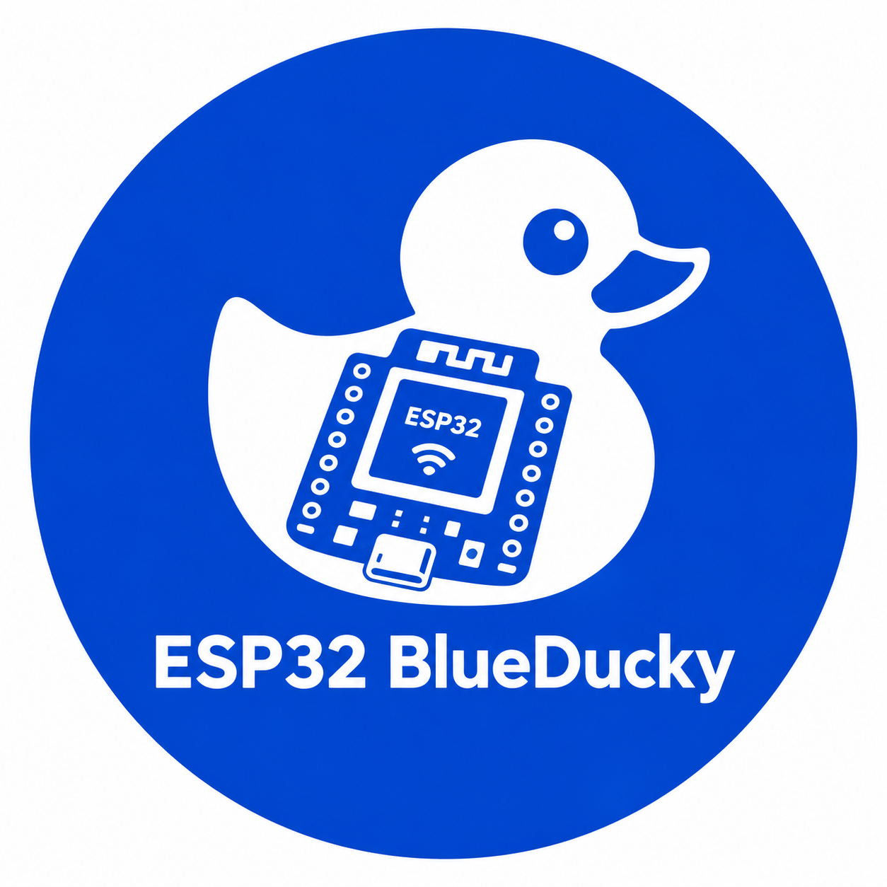

# "ESP32 BLUEDECKY" 🦆

⚠️ **DISCLAIMER** ⚠️
`FOR EDUCATIONAL PURPOSES AND CYBERSECURITY TESTING ONLY.
This project is created solely for educational purposes, security research, and testing. Unauthorized use on devices without explicit permission is strictly prohibited and illegal. The developer assumes no responsibility or liability for any misuse or damage caused by this software.`

---

### 🌟 WHAT'S NEW IN THIS UPDATE
- **Wi-Fi Admin Panel (http://192.168.4.1):** ഡിവൈസിന്റെ Wi-Fi ബോർഡ് ആക്‌സസ്സ് പോയിന്റിലേക്ക് കണക്ട് ചെയ്ത് ബ്രൗസറിൽ `192.168.4.1` വഴി അഡ്മിൻ പാനൽ ലഭ്യമാകും.
- **Automatic Keylogger:** സെറ്റ് ചെയ്ത ഫേംവെയർ പശ്ചാത്തലത്തിൽ ഓട്ടോമാറ്റിക് ആയി കീലോഗർ ആയി പ്രവർത്തിക്കും.
- **Custom Payload Control:** അഡ്മിൻ പാനൽ വഴി മുൻകൂട്ടി തയ്യാറാക്കിയ കോഡുകൾ കസ്റ്റമൈസ് ചെയ്യാനും പുതിയ കമാൻഡുകൾ ലൈവായി അയക്കാനും സാധിക്കും.

---

# How It Works & Installation

🌏 **Flash Firmware:** 📥
Flash/Install the `.bin` files onto your ESP32 board using your preferred ESP flashing tool.

⚡ **Power Up:**
Flash the `.bin` code now. Use this website to flash:
[https://esptool.spacehuhn.com/](https://esptool.spacehuhn.com/)

---

# FLASHING INSTRUCTION

| File Name | Offset |
| :--- | :--- |
| `bootloader.bin` | `0x1000` |
| `partitions.bin` | `0x8000` |
| `firmware.bin` | `0x10000` |

---

# Features & Usage

⚙️ **1. Power & Bluetooth Connection:** 📱🔗
- Provide power supply to the ESP32 board via USB or an external battery source.
- Turn on Bluetooth on your mobile device and connect to the device named **"Bluedecky"**.

⚙️ **2. Automated Execution & Keylogger:** 🤖
- Pair your Android smartphone with the ESP32 BlueDecky (Bluetooth device name: **"Bluedecky"**).
- The device automatically executes pre-configured automated tasks on your connected device.
- Simultaneously runs background keystroke recording logic (Keylogger).

🌐 **3. Wi-Fi Admin Panel Access:** 💻
- Turn on Wi-Fi on your phone or PC and connect to the ESP32 Wi-Fi Hotspot network.
- Open any web browser and go to: **`http://192.168.4.1`**
- From the Admin Panel, you can:
  - View logged keystrokes.
  - Manage pre-set configuration scripts.
  - Send customized rubber ducky codes directly to the device.

---

# Requirements

⚙️ ESP32 Development Board  
⚙️ Power Cable / Battery Source 🔋  
⚙️ Smartphone (Android) 📱  
⚙️ Web Browser (Chrome/Firefox for accessing `192.168.4.1`)  
⚙️ IDE (Windows Working Environment)  

---

## DEVELOPER ##
`@TONIX`
